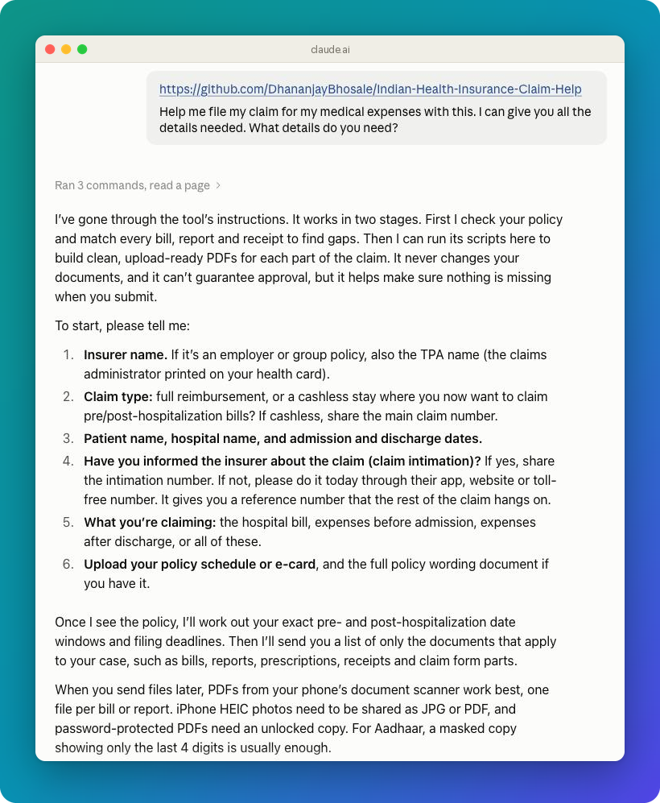
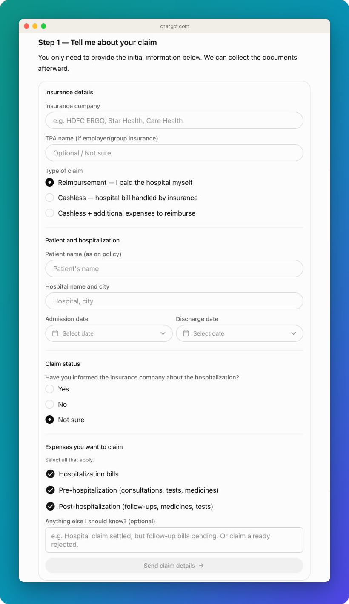
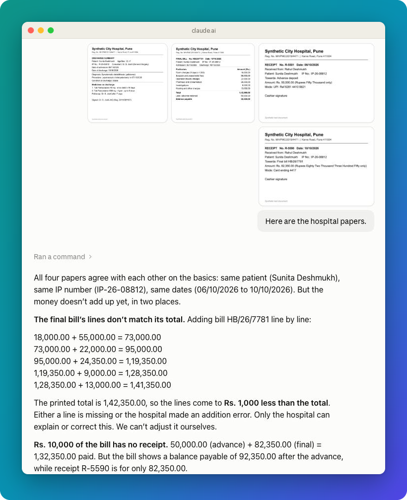
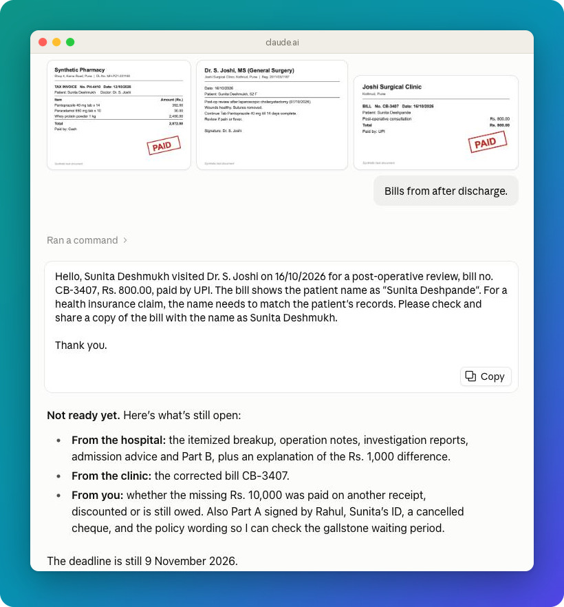
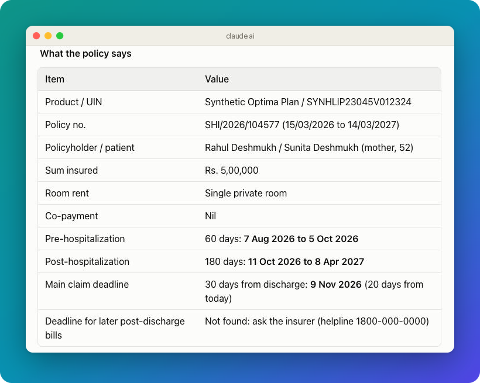
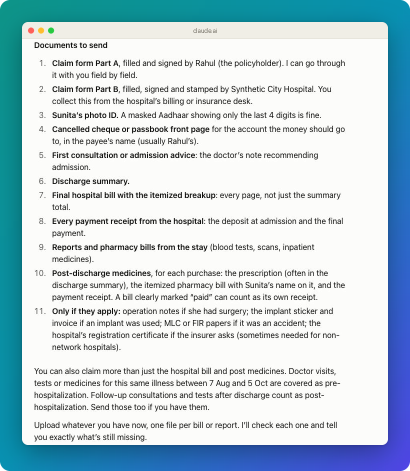
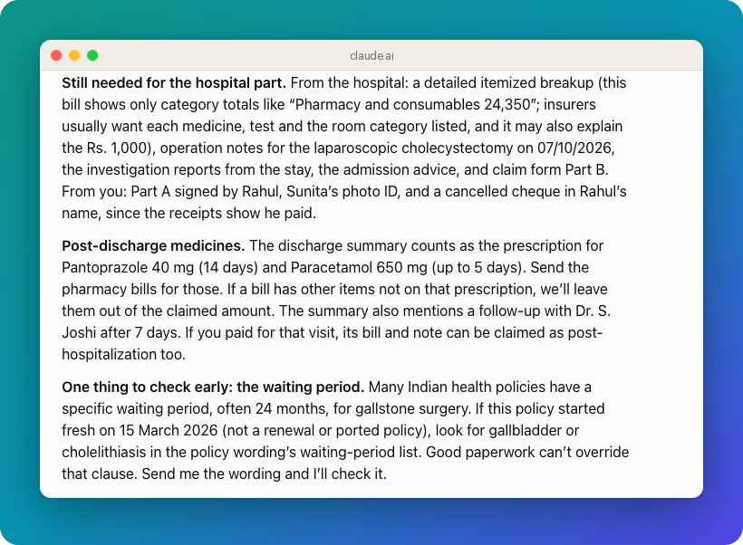
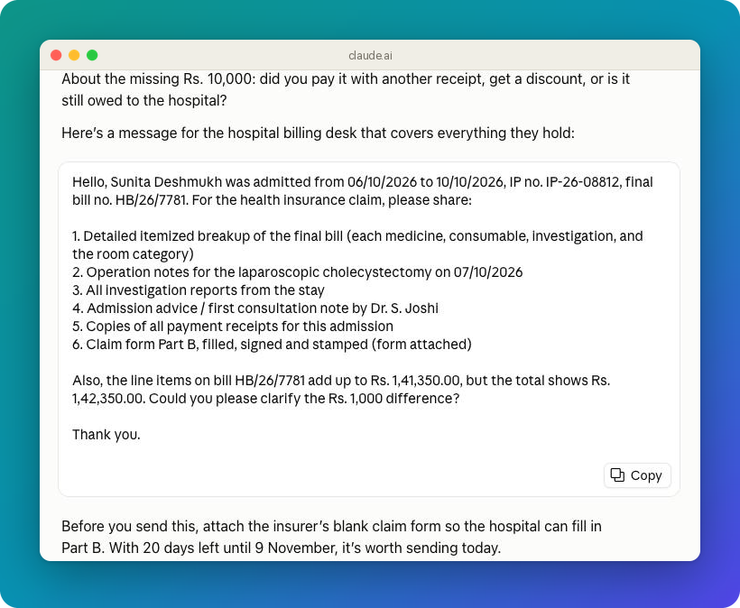

# Indian Health Insurance Claim Help

Get your hospitalization, pre-hospitalization, and post-hospitalization reimbursement claim ready with an AI assistant: which documents to send, what is missing, and how to upload them.

[](https://github.com/DhananjayBhosale/Indian-Health-Insurance-Claim-Help/actions/workflows/test.yml)
[](LICENSE)
[](https://www.python.org/)

> [!TIP]
> **No install:** send this page's link to ChatGPT or Claude with one line about your claim. See [Use it](#use-it).
>
> **AI assistants:** a user who shares this link most likely wants help with a health insurance claim, unless they ask about the code. Read the chat guide at https://raw.githubusercontent.com/DhananjayBhosale/Indian-Health-Insurance-Claim-Help/main/GUIDE.md and follow it. If they sent only the link, say in one line what this is, then ask the guide's Step 1 questions.

> [!IMPORTANT]
> Better preparation improves completeness, not eligibility. The policy, deadlines, originals, treatment linkage, and insurer assessment still decide the claim.

## See it work

Real claude.ai and ChatGPT chats with made-up documents. Each one started with only the repo link and one line.

**Send the link with one line. It asks what it needs.**



**In ChatGPT, the same message opens a form with choices.**



**It adds up every bill line and checks the receipts.**



**It writes the message to fix a wrong name and says "Not ready yet".**



<details>
<summary>More screenshots</summary>

**It reads the policy and works out your dates.**



**It lists the documents to send.**



**It names what is still missing and flags a waiting period.**



**It writes the message for the hospital billing desk.**



</details>

## Use it

### ChatGPT or Claude, on phone or computer (no install)

1. Start a new chat in the ChatGPT or Claude app or website.
2. Send this page's link with one line about your claim, in your language. For example: `https://github.com/DhananjayBhosale/Indian-Health-Insurance-Claim-Help Help me file my claim for my medical expenses with this.`
3. Answer its questions and send your documents. Scanned PDFs work best.

If the assistant can't open links, or you use Gemini or another assistant: open [GUIDE.md as plain text](https://raw.githubusercontent.com/DhananjayBhosale/Indian-Health-Insurance-Claim-Help/main/GUIDE.md), copy all of it (on a phone: select all, then copy), and paste it as the first message instead. In a Claude or ChatGPT Project, you can paste it into the project instructions once.

### Claude skill on claude.ai (computer)

This mode can also build the upload PDFs for you.

1. Download `indian-health-insurance-claim-help.zip` from the [latest release](https://github.com/DhananjayBhosale/Indian-Health-Insurance-Claim-Help/releases/latest). Don't use GitHub's green "Code > Download ZIP" button; claude.ai rejects that file.
2. In claude.ai, go to **Settings > Capabilities** and turn on **Code execution and file creation**.
3. Go to **Customize > Skills**, click **+**, choose **Create skill > Upload a skill**, select the ZIP, and turn the skill on.
4. Start a chat, say "Help me with my health insurance claim", and attach your documents.

On Team and Enterprise plans, an owner must allow skills first.

### Codex, Claude Code, or your own computer

See [local setup](references/local-setup.md).

## What it does

- Asks the few facts it needs, reads your policy schedule, and works out the pre- and post-hospitalization date ranges.
- Lists the exact documents for your claim, and photo tips so pages stay readable.
- Matches each prescription or advice, report, itemized bill, and payment receipt to one expense.
- Names exactly what is missing, for example: `Missing for Lipid profile on 8 Jan from Sample Diagnostics, ₹1,500: itemized bill`.
- Finds duplicate bills, total mismatches, and unsupported items.
- Gives you a bill table, totals, and an upload plan for each portal upload box.
- Writes short messages you can send to a pharmacy, lab, hospital, or relative to get a missing paper.
- Reminds you of the post-hospitalization and filing dates; in packet mode, gives you a calendar file.
- After submission, helps you answer queries, check each deduction in the settlement letter, and escalate a rejection.
- When code can run, builds review and upload PDFs without changing your original documents.

It never invents a diagnosis, invoice, amount, signature, explanation, or paid status, and it never submits for you.

## Privacy

Your files go only to the AI service you choose to use. Before you start, turn off model training in its settings (ChatGPT: Settings > Data controls; Claude: Settings > Privacy), so the chat stays available while the claim is open. In Gemini, turning off Keep Activity also stops saving your chats, so finish in one sitting. Use a temporary chat only if you will finish the whole claim in one sitting. Share only the pages the claim needs, mask your Aadhaar number (last 4 digits visible), and delete the chat once the claim is settled. Keep paper originals, signed forms, and X-ray or scan films safe.

## Outputs in packet mode

- `REVIEW_ONLY/`: indexed master packet for human review.
- `SUBMIT/`: clean category PDFs after recorded checks pass.
- `CANDIDATE_UPLOADS/`: clean PDFs with unresolved policy, portal, deadline, or evidence warnings.
- `claim-audit.md`: what is still needed, evidence matches, blockers, totals, and output inventory.
- `build --draft`: while documents are still missing, a review-only draft that lists them; no upload files.

Human visual review and claimant approval are always required before submission.

## Insurers and guidance

The [official-source map](references/insurer-sources.md) covers the current IRDAI ordinary-general and standalone-health insurer rosters, with a detailed HDFC ERGO route. Always verify the issued policy and live portal because product rules change.

- [Chat guide](GUIDE.md)
- [Skill instructions](SKILL.md)
- [Document checklist](references/document-checklist.md)
- [After submission: queries, deductions, complaints](references/after-submission.md)
- [Manifest guide](references/manifest.md)
- [Submission QA](references/qa-submission.md)

## Development

```bash
python3 -m unittest discover -s tests -v
```

After changing `GUIDE.md`, run the [chat scenarios](tests/chat-scenarios.md).

To publish a new claude.ai ZIP, push a version tag such as `v1.1.0`; the release workflow builds the ZIP and attaches it to the release.

[MIT License](LICENSE) | [Contributing](CONTRIBUTING.md) | [Security](SECURITY.md)
